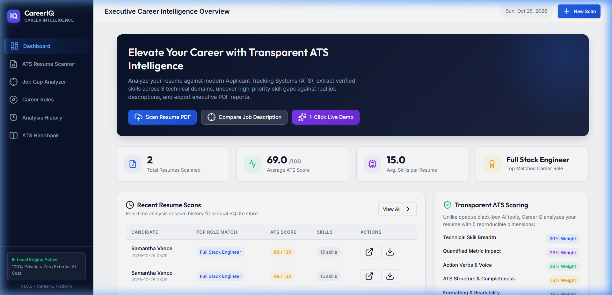
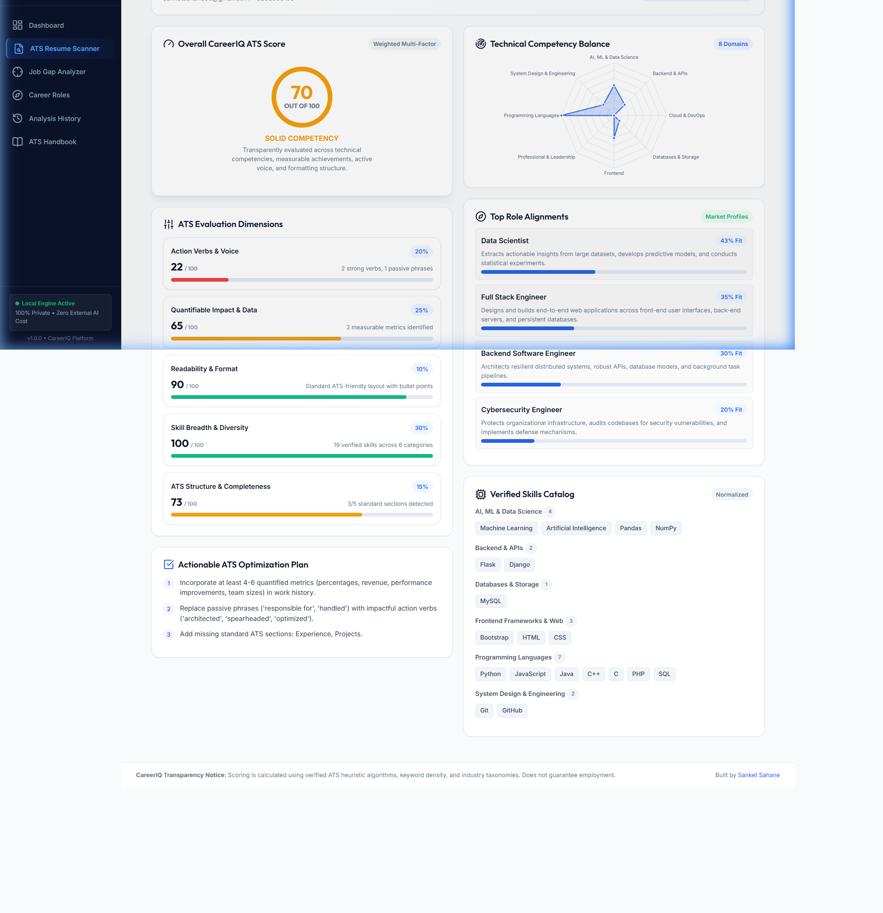
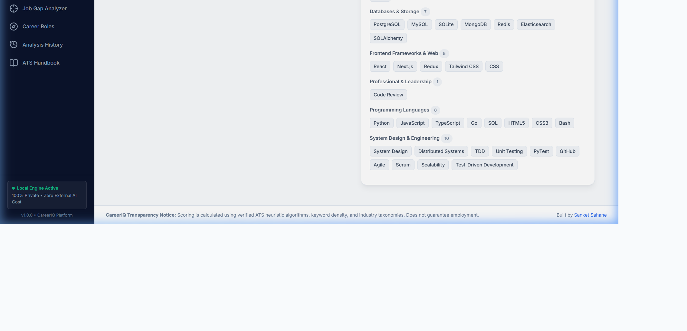
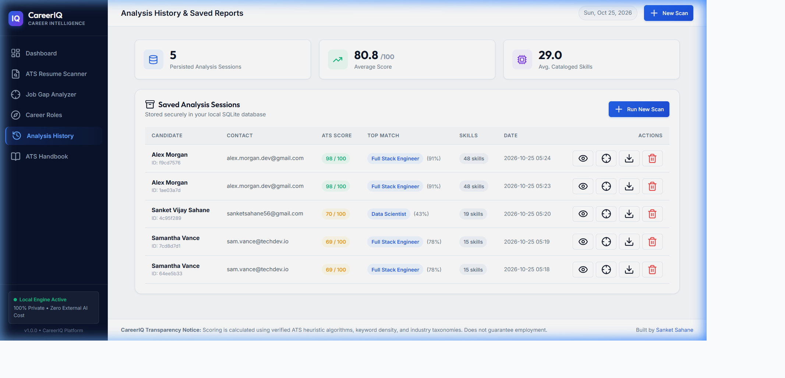
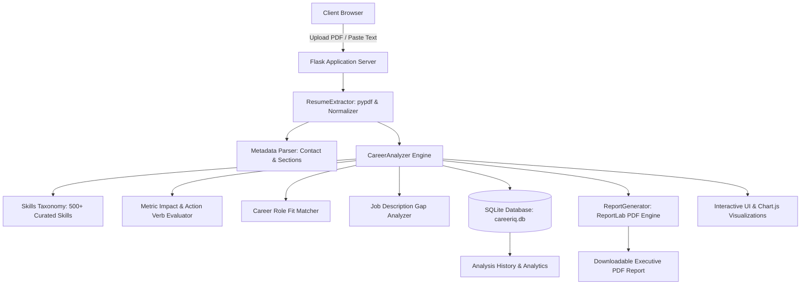

# CareerIQ &bull; AI-Powered Career Intelligence Dashboard

[](LICENSE)
[](https://www.python.org/)
[](https://flask.palletsprojects.com/)
[](https://www.chartjs.org/)
[](https://www.sqlite.org/)
[]()

> **CareerIQ** is a modern, portfolio-ready Career Intelligence and ATS Resume Analytics platform. Built with Python, Flask, SQLite, and vanilla CSS/JS, it evaluates resumes across 5 transparent dimensions, extracts 500+ technical competencies, conducts dual radar skill-gap analyses against target job descriptions, and generates executive PDF reports—**100% locally with zero paid third-party API dependencies**.

### 🔗 Live Access & Deployment
- **Live Website URL**: [https://careeriq-dashboard.onrender.com](https://careeriq-dashboard.onrender.com)
- **1-Click Cloud Deploy on Render**: [](https://render.com/deploy?repo=https://github.com/sanketsahane56/AI-Powered-Career-Intelligence-Dashboard)

---

## 📸 Application Screenshots

### 1. Executive Intelligence Dashboard


### 2. ATS Resume Scanner & Document Parsing


### 3. Multi-Factor Scorecard & Skills Radar Analysis


### 4. Persisted History & Saved Reports


---

## 🌟 Key Features

- **Transparent 5-Dimension ATS Scoring**:
  - **Skill Breadth & Diversity (30%)**: Analyzes breadth across tech and business categories (Languages, Web, Backend, Cloud, Databases, AI/ML, System Design, Product, Design, Marketing, Finance).
  - **Quantifiable Impact & Metrics (25%)**: Scans for percentages, dollar savings, throughput metrics, and user scales.
  - **Action Verbs & Voice (20%)**: Distinguishes leadership and engineering action verbs from passive phrasing.
  - **ATS Structure & Completeness (15%)**: Validates standard ATS sections (Experience, Skills, Education, Projects, Contact metadata).
  - **Readability & Formatting (10%)**: Evaluates word density, page structure, and bullet format.
- **Deep Skill Extraction Engine**:
  - Curated taxonomy of **500+ verified skills** with alias normalization (`k8s` &rarr; `Kubernetes`, `react.js` &rarr; `React`, `psql` &rarr; `PostgreSQL`, `figma` &rarr; `Figma`).
- **Target Role Compatibility**:
  - Automatically benchmarks candidate skills against top market tracks: *Full Stack Engineer, Backend Engineer, Frontend Engineer, Data Scientist, ML Engineer, DevOps/Cloud, Data Engineer, Cybersecurity, Product Manager, UI/UX Designer, Growth Marketer*.
- **Job Description Gap Analysis**:
  - Paste any custom Job Description (or select built-in industry presets).
  - Computes match percentage, lists matched skills (green tags), high-priority skill gaps (red tags), and plots a dual **Resume vs Job Requirements Radar Chart**.
- **Executive PDF Report Generator**:
  - Built-in report builder using `reportlab` creating branded, downloadable executive summaries with scorecards, domain breakdowns, and action checklists.
- **SQLite Persistence & History**:
  - Automatically records every analysis session in a local SQLite database (`data/careeriq.db`).
  - View previous scans, inspect previous scores, download reports, or compare with new jobs.
- **1-Click Multi-Domain Demo Preloaders**:
  - Instantly test with 1 click across Software Engineering, Product Management, Data Science, UI/UX Design, and Growth Marketing sample profiles (`data/sample_resume_*.txt`).
- **Zero Paid AI Dependencies & 100% Privacy**:
  - All parsing and scoring algorithms run locally via transparent rule-based heuristics and NLP tokenization. No data is sent to external paid AI APIs.

---

## 🏗️ Architecture Overview



---

## 🛠️ Technology Stack

| Layer | Technology | Purpose |
|---|---|---|
| **Backend** | Python 3.10+, Flask 3.1 | Web application framework and REST APIs |
| **PDF Extraction** | `pypdf` | Fast, secure text extraction from PDF documents |
| **Reporting** | `reportlab` | Vector-rendered executive PDF report generator |
| **Data & Storage** | SQLite, Pandas | Session persistence and analytical aggregations |
| **WSGI Servers** | Gunicorn (Linux/Render), Waitress (Windows) | Multi-threaded production web serving |
| **Frontend UI** | HTML5, Vanilla Modern CSS | Dark navy sidebar (`#0F172A`), electric blue accents |
| **Data Viz** | Chart.js 4.4 | Radar charts, gauge metrics, and comparative graphs |
| **Icons & Fonts** | Lucide Icons, Google Fonts (Outfit & Inter) | Crisp typography and vector icons |
| **Testing** | `pytest` | Comprehensive unit and integration test suite (21 tests) |

---

## 🚀 Quick Start (Local Setup)

### Prerequisites
- Python 3.10 or higher
- Git

### 1. Clone the Repository
```bash
git clone https://github.com/sanketsahane56/AI-Powered-Career-Intelligence-Dashboard.git
cd AI-Powered-Career-Intelligence-Dashboard
```

### 2. Create and Activate Virtual Environment
**Windows (PowerShell):**
```powershell
python -m venv venv
.\venv\Scripts\Activate.ps1
```

**Linux / macOS:**
```bash
python3 -m venv venv
source venv/bin/activate
```

### 3. Install Dependencies
```bash
pip install -r requirements.txt
```

### 4. Configure Environment (Optional)
```bash
cp .env.example .env
```

### 5. Run the Application
**Development Mode:**
```bash
python app.py
```

**Production WSGI Server (Cross-platform):**
```bash
python wsgi.py
```
Open your browser and navigate to: **`http://localhost:5000`**

---

## 🧪 Running Automated Tests

Run the full automated test suite covering extraction, scoring heuristics, database persistence, PDF report generation, multi-domain sample APIs, and routes:

```bash
pytest -v
```

### Test Coverage Summary:
- `tests/test_extractor.py`: PDF stream parsing, plain text normalization, metadata regex.
- `tests/test_analyzer.py`: Skill taxonomy extraction, metric detection, verb scoring, job gap analyzer.
- `tests/test_db.py`: SQLite schema initialization, session CRUD operations, aggregate statistics.
- `tests/test_report.py`: In-memory PDF document generation with valid `%PDF-` binary output.
- `tests/test_routes.py`: Web page routes (`/`, `/scanner`, `/job-match`, `/roles`, `/history`, `/guide`), Multi-domain Sample Resume API, Job Gap Compare API, Delete Analysis API, and custom 404 handler.

---

## 🌐 Cloud Deployment Guide

### Option 1: Deploy on Render (Recommended)
This repository includes a native **`render.yaml`** blueprint for automatic deployment on Render:

1. Push this repository to your GitHub account.
2. Sign in to [Render](https://render.com/).
3. Click **New +** &rarr; **Blueprint**.
4. Connect this GitHub repository: `AI-Powered-Career-Intelligence-Dashboard`.
5. Render will automatically detect `render.yaml`, install `requirements.txt`, and run `gunicorn wsgi:app`.
6. Your live website URL will be provisioned automatically (e.g. `https://careeriq-dashboard.onrender.com`).

### Option 2: Deploy on Railway / Heroku
The included **`Procfile`** contains the standard web process command:
```
web: gunicorn wsgi:app
```
Connect your GitHub repository in the Railway or Heroku dashboard, and the platform will automatically build and deploy.

### Option 3: Deploy with Docker
Build and run the containerized application on any cloud or local Docker engine:
```bash
docker build -t careeriq-dashboard .
docker run -p 5000:5000 careeriq-dashboard
```

### Option 4: Deploy on Vercel
The repository includes a ready-to-use **`vercel.json`** file configured for serverless Python deployment:
```bash
vercel --prod
```

---

## 🔒 Security & Privacy Practices

- **Zero Data Leakage**: No resume text, contact details, or candidate data is sent to external third-party AI APIs.
- **Sanitized Uploads**: Filenames are sanitized via Werkzeug `secure_filename`. File size is restricted to 10MB.
- **Git Hygiene**: `.gitignore` strictly protects database files, session data, PDF uploads, temporary reports, and virtual environments.

---

## ⚠️ Disclaimer

CareerIQ provides automated analysis based on common Applicant Tracking System (ATS) guidelines, keyword taxonomy patterns, and engineering best practices. Resume scores and match percentages are indicative heuristics designed to assist job seekers and **do not guarantee job interviews or employment offers**.

---

## 📄 License

This project is licensed under the MIT License - see the [LICENSE](LICENSE) file for details.

Developed with ❤️ by [Sanket Sahane](https://github.com/sanketsahane56).
